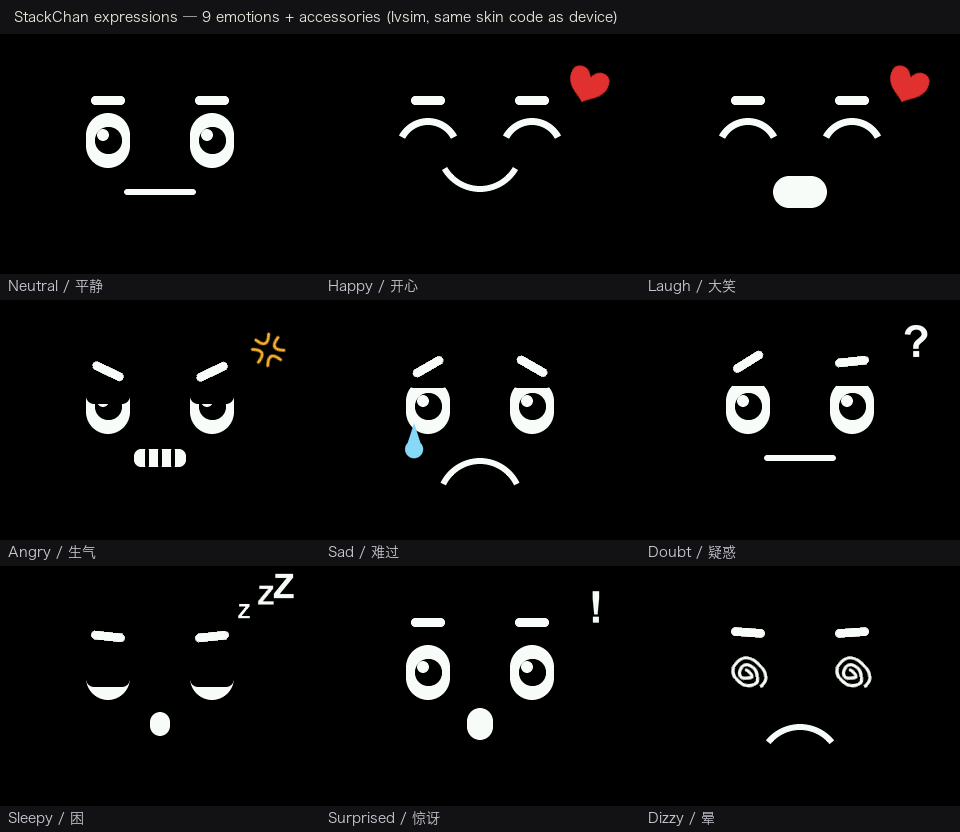
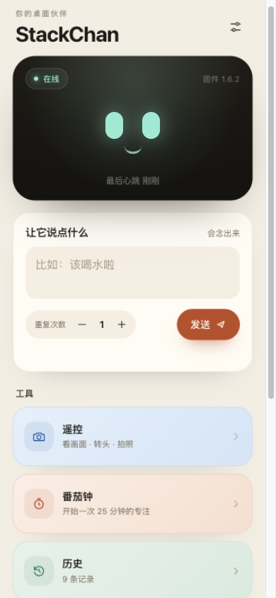
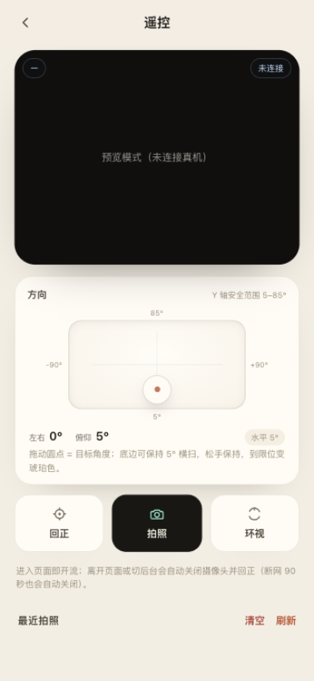
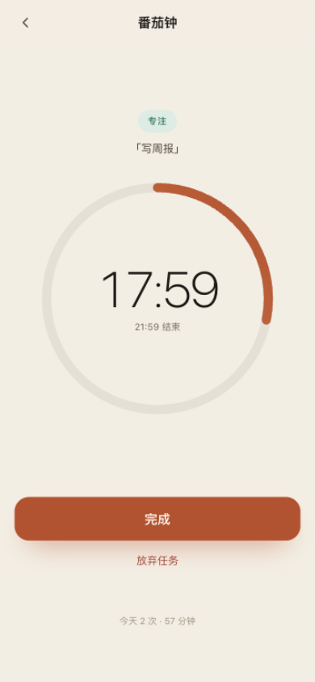
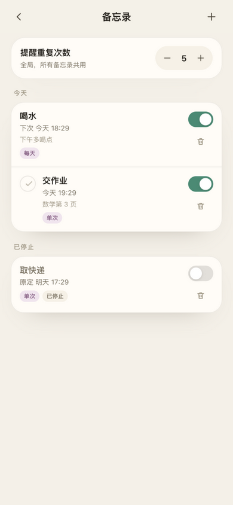
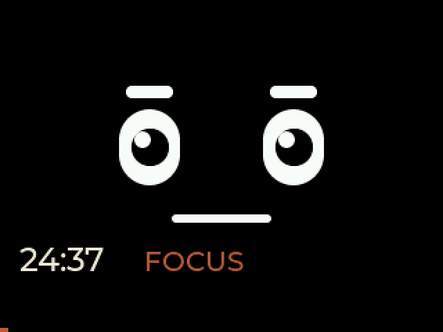
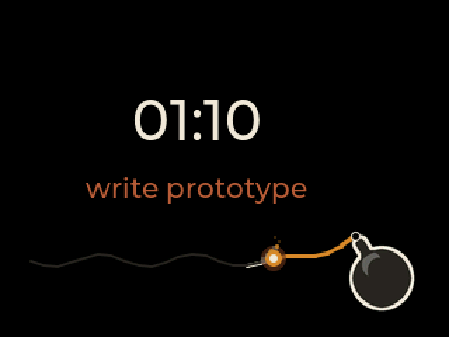

# StackChan K151：自建服务端 + 自定义固件

> **这不是 M5Stack 官方固件。** 这是一个基于 [M5Stack/StackChan](https://github.com/m5stack/StackChan)
> 的 fork，把桌面机器人从官方云改到**自己的局域网服务端**，并加入表情、行为消息、遥控、
> 番茄钟、备忘录和 Android 壳。
>
> 目标设备：**StackChan K151**（ESP32-S3 / 16MB flash / 8MB PSRAM）。
> 其他 CoreS3 型号不保证可用。

## 它能做什么

不是“再接一个大模型聊天”，而是把语音、表情和身体交互都放到**自己的局域网服务端**上：

| 能力 | 实际体验 |
|---|---|
| **自己的 LLM** | 配置页填任意 OpenAI **Chat Completions** 兼容的 API URL / 模型 / Key；默认 DeepSeek `deepseek-flash`，也可换 OpenAI、Qwen 或自建端点 |
| **自建语音** | 点屏幕开始说话；服务端 FunASR 本地识别 → 你的 LLM → EdgeTTS；不连官方云 |
| **表情** | 9 种重新设计的面部表情（相对官方原版）+ 爱心/眼泪/问号/感叹号/青筋/Zzz 配饰；跟随回复里的 emoji 变 |
| **身体交互** | 摸头、摇晃有反应；位置只做弱提示（硬件只有 5 档），不要依赖精确坐标 |
| **行为消息** | 手机发一句，设备按次数播报 + 点头/表情/LED；断线重连后重放；配合 Tailscale 可在外面给家里人发语音消息 |
| **遥控** | 手机宽盘摇杆拖头（绝对角度）；实时视频/拍照；配合 Tailscale 可在外面看看家里/宠物（轻量监控，不是安防级） |
| **番茄钟** | 语音开始/关闭；专注 / 引线 / 超时三段，设备 HUD；到点播报；长按抽屉完成/放弃/继续 |
| **备忘录** | App 创建单次/循环（每天/每周/每月/工作日）；到点暖黄 LED + 点头 + 播报「提醒你，<标题>」；点屏幕停止；支持暂停/恢复/删除、历史筛选 |
| **记忆（可选）** | `mem_core` 保存摘要/事件，跨会话参考；可一键关闭 |
| **Android 壳** | 通用 APK，首启填地址 + Token；APK 不烧死 host/token；照片下载 |
| **配置页** | 浏览器改 LLM/天气/时区/人设；Token 自动生成；测试按钮；保存重启/失败回滚；仅 localhost |
| **构建套件** | 源码 + ESP-IDF 6.1 脚本；只刷 app + otadata；无 CI、无预编译固件 |

### 2026-11-16 新增

- **语音番茄钟**：说「开始 25 分钟番茄钟」即可开始；到点后说「关闭番茄钟」会先查当前计时，到点按完成、计时中按放弃，不再出现「我这边没有在跑」。
- **备忘录**：App 里建单次/循环提醒，到点设备暖黄灯 + 点头 + 播报，默认 5 遍；播报中点屏幕直接停止并回待机。
- **LED 左右对称**：状态/隐私/番茄钟/行为灯统一为左右各一颗（0/11），不再只亮左侧。

### 两个远程场景

- **在外面给家里人发语音消息**：手机开 Tailscale → 打开 App → 发一句“该吃饭了”，设备会按设定次数播报并做表情/点头；服务端不用暴露到公网。
- **在外面看看家里/宠物**：手机开 Tailscale → 遥控页拖头、看视频、拍照；照片可以保存到手机。定位是轻量监控，不是安防摄像头。

### 表情是重新设计的

不是沿用官方原版、也不是只换颜色：本 fork 重新画了 9 种表情，并给不同情绪加了爱心、
眼泪、问号、感叹号、青筋、Zzz 等配饰。下图由 `lvsim` 渲染，和真机跑的是同一份 C++ 皮肤代码：



### App 与设备界面

App 截图来自本地 `ui_preview.py` 的假数据（不涉及真实消息/相机）；设备端番茄钟用 `lvsim`
渲染，和真机共用同一份 `countdown_overlay` 代码。

<p align="center">
  
  
  
</p>

<p align="center"><sub>消息 / 遥控（预览模式）/ 番茄钟</sub></p>

<p align="center">
  
</p>
<p align="center"><sub>备忘录：单列表、日期分组、已停止组；到点可点屏幕停止</sub></p>

<p align="center">
  
  
</p>

<p align="center"><sub>设备屏幕：正常专注阶段 / 最后 20% 的引线（炸弹）阶段。lvsim 环境没有 CJK 字体，标签回退英文；真机用主题字体显示中文。</sub></p>

**适合谁**

- 有 StackChan K151、Docker 和局域网，想把自己的语音/表情/遥控放在家里的；
- 想接自己的 LLM/TTS、改表情/行为、做二次开发的；
- 能接受用 ESP-IDF 6.1 在本机编译固件的人。

**不适合谁**

- 想要官方 App 开箱即用、完全不想碰 Docker/IDF 的；
- 需要精确触摸坐标、高帧率视频或安防级摄像头的。

### 当前构建的边界

- 默认**关闭语音唤醒**（`CHAN_DISABLE_WAKE_WORD=1`）以降低内存/延迟；**只有点屏幕开始说话，摸头不会开始对话**；要 “Hi StackChan” 需要重编开启。
- 当前身体交互只有**摸头**和**摇晃**；触摸位置只有 5 档且邻块串扰，**不要依赖精确坐标**。
- 相机 QVGA，遥控视频约 3fps；不是安防摄像头。
- 记忆默认 `nomem`，开启后是全家人共用一个桶。
- 备忘录目前只支持 App 创建；语音创建（`create_memo`）还在规划中，未上线。
- EdgeTTS 没有 SLA；LLM 需要你自己的 API key。
- 非官方固件，只针对 K151。

## 它由哪几块组成

```
StackChan K151
  ├─ 语音 WS :8000  ──► xiaozhi-esp32-server（ASR / LLM / TTS）
  ├─ OTA   :8003  ──► 同一服务端（只用来拿 websocket.url）
  └─ 控制 WS :8100 ──► chan-behavior（消息、行为、遥控、番茄钟）
                           ▲
                           │ HTTPS（Tailscale Serve / Caddy）
                           │
                        手机 App / 浏览器
```

- **设备 → 服务端**：局域网地址（`DEVICE_HOST`），设备不跑 Tailscale。
- **手机 → 服务端**：局域网或 Tailscale（`PUBLIC_BASE_URL`）。
- 服务端配置页**只绑 `127.0.0.1:8200`**，需要时用 SSH 隧道打开。

## 你需要装什么

| 用途 | 需要 | 版本 / 说明 |
|---|---|---|
| 跑服务端 | **Docker Engine** 或 Docker Desktop / OrbStack；**Docker Compose v2** | Linux / macOS；建议 4GB 内存、8GB 更稳；至少 5GB 空闲磁盘（ASR 模型约 893MB + 镜像） |
| 改服务端配置 | **Python 3.9–3.14** | 只用标准库 + `selfhost/setup/requirements.txt`（FastAPI/uvicorn/httpx/PyYAML）；实测 3.9/3.12/3.14 |
| 编译固件 | **ESP-IDF 6.1**（不是 5.5） | Python 3.12（IDF 自带 venv）、Git、cmake/ninja、至少 5GB 磁盘 |
| 刷固件 | **USB-C 数据线** + esptool | esptool 随 ESP-IDF 安装；优先底座 USB-C 口 |
| 构建 Android App（可选） | **JDK 21**、**Android SDK 36**、**Node.js 20+ / npm** | Gradle wrapper 已带；Android Studio 可选；release 签名用你自己的 keystore |
| 手机 | Android 7+（minSdk 24）或 iPhone Safari | Android 原生壳；iOS 用 PWA“添加到主屏幕” |
| LLM | **任意 OpenAI Chat Completions 兼容 API Key** | 默认 DeepSeek `deepseek-flash`；也可填 OpenAI、Qwen 或自建兼容端点；配置页可换 URL/模型/Key |
| 天气（可选） | **和风天气 API Key** | 免费开发版即可，填控制台给的 API Host；没有也能正常对话 |
| 语音合成 | 不需要 key | 服务端内置 EdgeTTS |
| 远程访问（可选） | **Tailscale** | 手机和服务器加入同一 tailnet；不要开 Funnel |

> 不需要：官方云账号、M5Stack App Center 密钥、Node/Python 以外的云服务。
> 官方 StackChan World App 不能连这套自建服务端。

## 四步跑起来

### 1. 服务端

```bash
git clone https://github.com/ninipa/stackchan-selfhost.git
cd stackchan-selfhost

python3 -m venv .venv
.venv/bin/pip install -r selfhost/setup/requirements.txt

# 本机有桌面：
./selfhost/setup/run.sh          # 浏览器打开 http://127.0.0.1:8200

# 无头服务器：一条 SSH 命令把 8200 转发到本机，同时前台运行
ssh -L 8200:127.0.0.1:8200 user@server \
  'cd /path/to/repo && ./selfhost/setup/run.sh'
```

在配置页填：

- `DEVICE_HOST`：设备能访问到的服务器局域网 IP/主机名；
- `PUBLIC_BASE_URL`：手机能访问到的地址（LAN 或 Tailscale HTTPS）；
- LLM API URL（完整到 `/chat/completions`，可换成任意兼容端点）、模型 ID、Key；
- 天气 Key（可选）、时区（下拉，默认自动识别）、人设。

第一次「保存并重启」会自动生成 `APP_TOKEN` / `DEVICE_TOKEN`，并重启两个容器。
底部「固件配置」「App 配对」卡片里的值分别给固件和 App 用。

不用配置页也可以走 CLI：

```bash
cd selfhost
cp deploy.env.example deploy.env
# 填 DEVICE_HOST / PUBLIC_BASE_URL / LLM_API_KEY / 两个 token
./tools/render-config.sh --write
docker compose up -d
./tools/doctor.sh
```

配置页固定只绑 localhost；远程只能 SSH 隧道，不要把它暴露到公网。详见
[`selfhost/setup/README.md`](selfhost/setup/README.md)。

### 2. 编译固件

```bash
cd firmware
cp local.conf.example local.conf
# CHAN_SERVER_HOST = 服务器局域网 IP
# CHAN_DEVICE_TOKEN = 配置页「固件配置」卡片里的值
./tools/configure.sh
./tools/check-env.sh
./tools/build.sh
```

### 3. 刷固件

```bash
cd firmware
./tools/flash-app.sh --yes
```

只写 app 分区 + otadata。**不要**：

- `idf.py flash`：会把 assets 分区里的唤醒词模型覆盖掉；
- `erase-flash`：会清 NVS（Wi-Fi、绑定、舵机零点）。

设备首次启动按屏幕 Setup 配 **2.4GHz Wi-Fi**。完整步骤和排错见
[`firmware/BUILD.md`](firmware/BUILD.md)、[`firmware/TROUBLESHOOTING.md`](firmware/TROUBLESHOOTING.md)。

### 4. 手机 App（可选）

Android 壳在 `shell/`；也可以直接用手机浏览器打开服务端地址。

```bash
cd shell
npm ci
npx cap sync android
cd android
JAVA_HOME="<JDK 21 路径>" ANDROID_HOME="$HOME/Library/Android/sdk" \
  ./gradlew assembleRelease
```

首次启动填服务器地址 + App Token。APK 不烧死地址/token；改 UI 不需要重发 APK。
详见 [`shell/README.md`](shell/README.md)。

## 端口与网络

| 端口 | 服务 | 谁访问 |
|---|---|---|
| 8000 | 语音 WebSocket | 设备 |
| 8003 | OTA + 视觉接口 | 设备 |
| 8100 | 行为服务 / App / 遥控视频 | 设备 + 手机 |
| 8200 | 服务端配置页 | **仅服务器本机**（SSH 隧道） |

- 不要把 8000/8003/8100 直接转发到公网；需要外网就用 Tailscale/tailnet。
- `DEVICE_HOST` 必须是设备能访问到的局域网地址；换网络/换 IP 后要改配置并重启设备。
- 设备只用 **2.4GHz Wi-Fi**，不能连网页认证网络。

## 硬件安全红线

- **Y 轴（俯仰）只能 5°–85°。** 极限角会堵转并**永久损坏舵机**。
- 不确定舵机是否通电受控时，不要用手掰头。
- 刷机前先做整片备份；整片备份含 Wi-Fi 密码和绑定 token，**不要上传/分享**。
- 换第三方固件前先在 StackChan World / 设备 Setup 里解绑。
- 不要整片写 `assets` 分区；唤醒词模型在里面。

## 平台矩阵

| 部分 | 已验证 | 说明 |
|---|---|---|
| 服务端 | macOS arm64（OrbStack）+ Docker | Linux Docker 理论可用；Windows 建议 WSL2 |
| 配置页 | macOS Python 3.12、mini Python 3.9、clean clone Python 3.14 | 3.9–3.14 实测；固定 localhost |
| 固件 | macOS + ESP-IDF 6.1 | Linux/WSL2 按官方 IDF 流程；原生 Windows 未测试 |
| Android 壳 | Android（Oppo）实测 | minSdk 24；JDK 21 / SDK 36 |
| iOS | Safari PWA | 无原生壳，添加到主屏幕 |

没有 CI、没有预编译固件、没有 PR 队列。固件由你自己在本机编译；遇到问题请附
`check-env.sh` 输出、构建日志和串口日志。

## 目录

```
firmware/     固件（M5Stack/StackChan fork；ESP-IDF 6.1）
selfhost/     自建服务端 + 配置页 + 行为服务
shell/        Android WebView 壳（Capacitor 8）
tools/        开发/验证工具（lvsim、抓帧、素材生成…）
docs/         架构与协议
```

## 文档

- [架构](docs/ARCHITECTURE.md)
- [行为控制面协议](docs/PROTOCOL.md)
- [固件构建](firmware/BUILD.md) / [排错](firmware/TROUBLESHOOTING.md)
- [服务端配置页](selfhost/setup/README.md)
- [服务端说明](selfhost/README.md)
- [Android 壳](shell/README.md)
- [开发](DEVELOPMENT.md) / [测试](TESTING.md) / [扩展](EXTENDING.md)
- [变更记录](CHANGELOG.md) / [发布流程](RELEASE.md)
- [安全](SECURITY.md) / [隐私](PRIVACY.md) / [贡献](CONTRIBUTING.md)

## 许可与第三方

固件基于 M5Stack/StackChan（MIT）；服务端依赖 xiaozhi-esp32-server、xiaozhi-esp32、
mooncake、LVGL、Noto 字体、SenseVoice、EdgeTTS 等第三方项目。各自许可见对应上游仓库和
`NOTICE`/`LICENSE`。本项目不是 M5Stack 官方产品，使用“StackChan”名称仅用于说明硬件兼容性。
